### `$ cat about.txt`

```text
> focus     Exploring new technologies, building software solutions and quick hacks
> role      Founder @ Giolosts · DevOps & Platform Engineer
> studied   CoET, Technological University of the Philippines
> learning  Cloud Architecture, Systems Design, Artificial Intelligence
> hobbies   Graphic Design, Blog Writing
```

### `$ ls ~/stack`


### `$ git stats`

<p align="center">
<a href="https://github.com/jhonatsz">
  
  
</a>
</p>

<p align="center">
<a href="https://github.com/jhonatsz">
  
</a>
</p>

### `$ uptime`

<p align="center">
<a href="https://github.com/jhonatsz">
  
</a>
</p>

### `$ ping jhonatsz`

<p align="center">
<a href="https://www.jhonatsz.dev"></a>
<a href="mailto:jhonathan@giolosts.co"></a>
<a href="https://linkedin.com/in/jhonatsz"></a>
<a href="https://instagram.com/jhonatsz"></a>
<a href="https://facebook.com/jhonatsz"></a>
</p>
